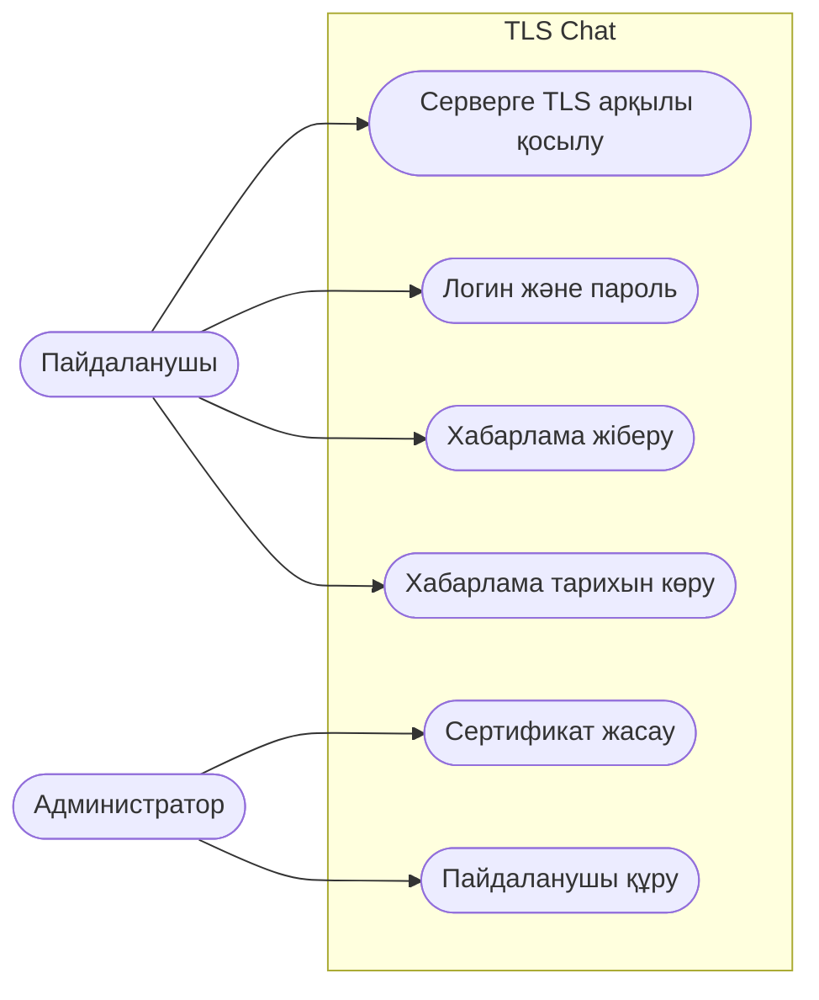
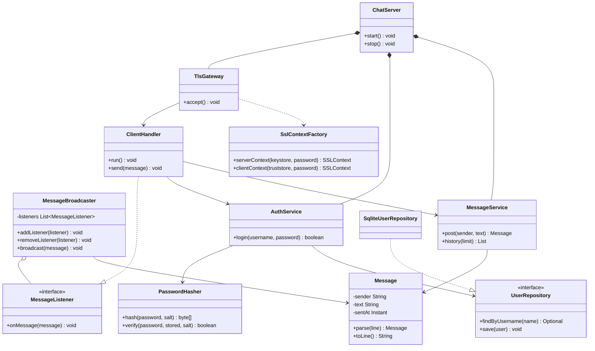
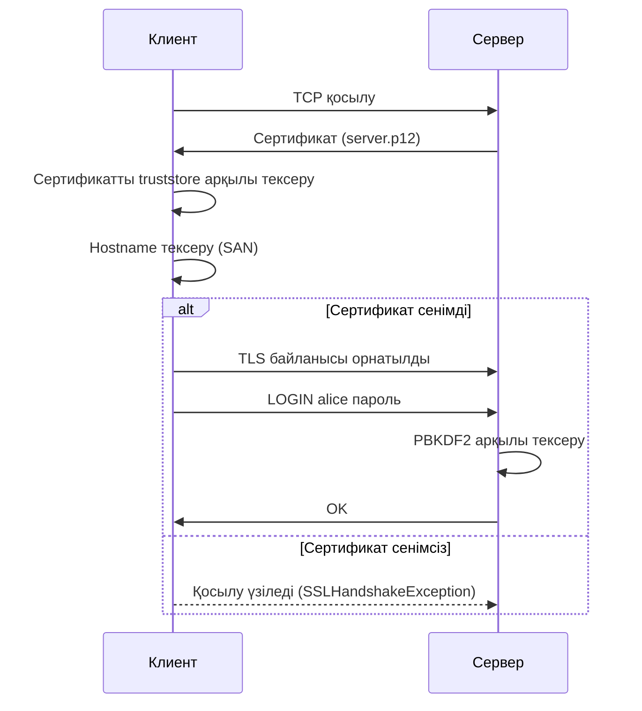
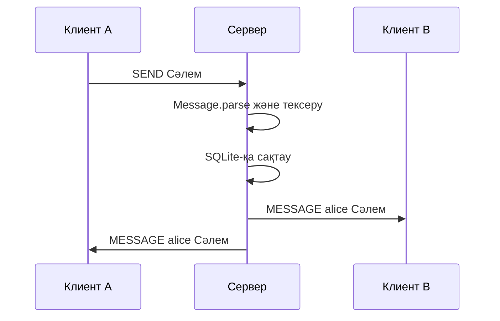
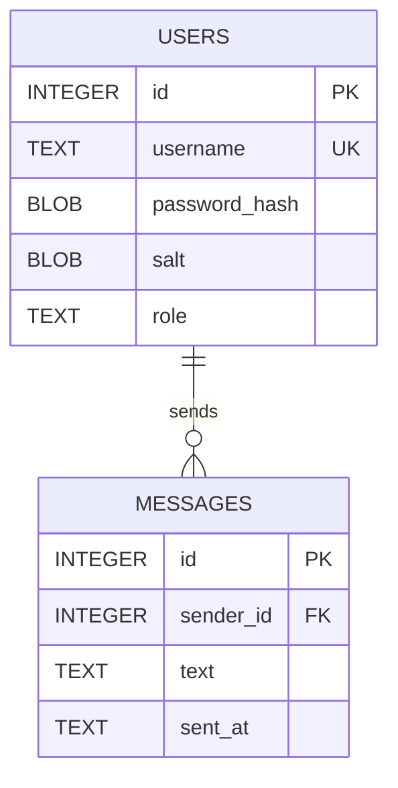

# TLS Chat: қауіпсіз клиент-сервер чат

**Жоба кезеңі:** заготовка проекта и TLS-основа
**Негізгі технологиялар:** Java 25, Maven, javax.net.ssl, keytool, PBKDF2, SQLite, JUnit 5
**Интерфейстер:** Swing десктоп клиенті және веб-клиент (телефон браузерінен ашылады)
**Тақырып:** 5, 14. TLS-чат
**Орындаушы:** Мулаев Ерасыл

## 1. Жоба мақсаты

TLS-чат — TLS арқылы қорғалған корпоративтік мессенджердің оқу-жобалық қаңқасы. Бұл кезеңде тек Maven құрылымы, TLS контексттерін құру негізі және интерфейс үлгісі дайындалады. Тіркеу, рөлдер, чаттар және хабар алмасу келесі кезеңдерге қалдырылады.

## 2. Негізгі міндеттер

- `keytool` арқылы өзі қол қойған сертификат пен PKCS12 KeyStore жасау
- `KeyStore` және `SSLContext` арқылы серверлік және клиенттік контекст құру
- `SSLServerSocket` арқылы клиенттерді қабылдау, `SSLSocket` арқылы қосылу
- Сертификатты және hostname-ді клиент тарапынан тексеру
- Логин мен парольмен кіру, парольдерді PBKDF2 арқылы хэштеу
- Бірнеше клиентті бір уақытта өңдеу және хабарламаларды тарату (broadcast)
- Сенімсіз сертификаты бар клиенттің қосылуын бөгеу
- JUnit 5 арқылы тесттеу және GitHub Actions арқылы автоматты тексеру

## 3. Жоспарланған функциялар

- [ ] `keytool` скрипті арқылы сертификат пен KeyStore жасау
- [x] TLSv1.3 серверлік және клиенттік `SSLContext` құру негізі
- [ ] `SSLServerSocket` серверін іске қосу
- [ ] `SSLSocket` клиенті және hostname тексеру
- [ ] Хабарлама протоколын жасау (`Message` класы)
- [ ] Логин және PBKDF2 арқылы парольді тексеру
- [ ] Бірнеше клиент және пул потоктары
- [ ] Broadcast: хабарламаны барлық қосылған клиентке жіберу
- [ ] Swing десктоп клиенті
- [ ] Веб-клиент (телефон браузерінде адаптивті көрініс)
- [ ] Хабарлама тарихын SQLite-та сақтау
- [ ] JUnit 5 тесттері (кемінде 20)
- [ ] GitHub Actions CI (бонус)

> Бұл жоспарланған функциялар тізімі. Тек іске асырылып, тексерілген мүмкіндіктер ғана `[x]` белгісімен белгіленеді.

## 4. Технологиялық стек

| Технология | Қолданылуы |
|---|---|
| Java 25 | Негізгі бағдарламалау тілі |
| Maven | Жобаны құрастыру және тәуелділіктер |
| keytool | Өзі қол қойған сертификат пен KeyStore жасау |
| javax.net.ssl | SSLContext, SSLServerSocket, SSLSocket |
| java.security | KeyStore, KeyManagerFactory, TrustManagerFactory |
| javax.crypto (PBKDF2) | Парольдерді хэштеу |
| Swing | Десктоп клиенті |
| com.sun.net.httpserver (HTTPS) | Веб-клиентке арналған сервер |
| SQLite + JDBC | Пайдаланушылар мен хабарламаларды сақтау |
| JUnit 5 | Тесттер |
| GitHub Actions | CI (`mvn verify`) |

## 5. Архитектура

Жүйе төрт қабаттан тұрады:

1. **Presentation:** Swing десктоп клиенті және браузердегі веб-бет.
2. **Application:** логин, хабарламаларды жіберу және тарату сценарийлері.
3. **Core:** TLS байланысы (`SslContextFactory`), хабарлама протоколы (`Message`), хэштеу (`PasswordHasher`).
4. **Persistence:** SQLite репозиторийлері.

Болашақта екі клиент те бірдей Application және Core қабаттарын пайдалануы керек. Қазіргі кезеңде нақты клиент пен сервер әлі жоқ; `SslContextFactory` тек TLS-контексттерін құруға арналған негіз болып табылады.

### Негізгі бағдарламалау паттерні: Observer

Хабарламаларды клиенттерге тарату үшін жобаның негізгі паттерні ретінде **Observer** таңдалды. `MessageBroadcaster` — хабарлама жариялаушысы (Subject), ал `MessageListener` — бақылаушы (Observer). Жаңа клиент қосылғанда ол listener ретінде тіркеледі, ал хабарлама келгенде `broadcast` барлық тіркелген клиенттерге шақырылады. Сондықтан хабар тарату логикасы нақты клиенттерге тәуелді болмайды.

Жаңа чат функциялары осы ережені сақтайды: хабарлама тікелей басқа клиентке жіберілмейді, алдымен Subject-ке беріледі, содан кейін барлық Observer-лерге таратылады.

## 6. UML диаграммалары

### 6.1 Use Case диаграммасы



### 6.2 Class диаграммасы



### 6.3 Sequence диаграммасы: TLS рукопожатие және кіру



### 6.4 Sequence диаграммасы: хабарламаны тарату



### 6.5 ER диаграммасы: деректер қоры



> Диаграммалар жоспарланған архитектураны көрсетеді. Нақты кластар мен схема іске асыру барысында осы модельмен сәйкестендіріліп, қажет болса жаңартылады.

## 7. Жұмыс принципі

1. Администратор сертификат жасап, сервер KeyStore мен клиент TrustStore файлдарын тарату.
2. Сервер `SSLServerSocket` арқылы портты тыңдайды.
3. Клиент қосылады, TLS рукопожатие орындалады, сертификат пен hostname тексеріледі.
4. Клиент логин мен парольді жібереді, сервер PBKDF2 арқылы тексереді.
5. Кіргеннен кейін клиент хабарлама жібереді. Сервер оны SQLite-қа жазып, барлық қосылған клиентке таратады.
6. Клиент ажыратылса, сервер басқа клиенттерді құлатпайды.

## 8. Жоба құрылымы

```text
tls-chat/
├── docs/
│   ├── screenshot.png
│   └── uml/
├── scripts/
│   └── gen-cert.sh
├── src/
│   ├── main/java/kz/.../tlschat/
│   │   ├── SslContextFactory.java
│   │   ├── ChatServer.java
│   │   ├── ClientHandler.java
│   │   ├── Message.java
│   │   └── ...
│   └── test/java/kz/.../tlschat/
├── .github/workflows/ci.yml
├── .gitignore
├── LICENSE
├── README.md
└── pom.xml
```

Бұл жоспарланған құрылым. Модульдер іске асыру барысында қосылады.

## 9. Қауіпсіздік және шектеулер

- Жоспарланған байланыс TLSv1.3 арқылы қорғалуы тиіс. Қазіргі кезеңде нақты желілік қосылым іске қосылмаған.
- Клиенттік контекст сенімді `TrustStore` арқылы құрылады; "барлығына сенетін" (trust-all) TrustManager қолданылмайды.
- Парольдер PBKDF2 арқылы хэштеледі, түпнұсқа пароль сақталмайды.
- Кілттер, парольдер, `.p12` және `.crt` файлдары репозиторийге түспейді, `.gitignore` арқылы қорғалады.
- Өзі қол қойған сертификат тек оқу мақсатында. Өндірісте сенімді CA қажет.
- Деректер дискіде шифрланбайды және сквозное (E2E) шифрлау жоқ. Бұл жобаның шектеуі.

## 10. Әзірлеу күйі

Қазіргі кезең: жоба қаңқасы және TLS контексттерін құру негізі. Нақты сервер, клиент, тіркеу, чат логикасы және сақтау қабаты әлі іске асырылмаған.

## 11. Жұмыс жоспары

Жұмыс 3 спринтке бөлінеді:

| Спринт | Мазмұны | Нәтиже |
|---|---|---|
| 1. Жоспар және архитектура | Зерттеу, Maven қаңқасы, `keytool` скрипті, SSLContext | Сертификат жасалады, TLS байланысы орнайды |
| 2. Негізгі функциялар | Логин, PBKDF2, хабарлама протоколы, broadcast, Swing клиенті, веб-бет | Екі клиент чатта хабарлама алмасады |
| 3. Қауіпсіздік және тесттер | Тесттер (кемінде 20), CI, README, скриншот, v1.0 | Релиз және қорғауға дайындық |

## 12. Тесттер жоспары

Кемінде 20 JUnit 5 тесті жоспарланған. Қазіргі кезеңде функционалдық тесттер әлі жазылмаған. Сертификат тесттің ішінде `@TempDir` арқылы уақытша жасалады, репозиторийде құпия файл болмайды.

- KeyStore: дұрыс файл, қате пароль, жоқ файл (3 тест)
- SSLContext: TLSv1.3 протоколы, серверлік және клиенттік контекст (3 тест)
- Қосылу: сервер мен клиент хабарлама алмасады, сенімсіз клиент үзіледі, қате hostname үзіледі (4 тест)
- Broadcast: хабарлама барлық клиентке жетеді, клиент ажыратылса сервер құламайды (2 тест)
- Логин: дұрыс және қате пароль, PBKDF2 тексеруі, бос логин (4 тест)
- Message: дұрыс жолды талдау, қате жолды қабылдамау, ұзын мәтін (4 тест)

## 13. Жұмыс процесі

- Тармақтар: `main` және `develop`. Жұмыс `feature/*` тармақтарында жүреді.
- `main` тармағына тек pull request арқылы кіреді, кемінде бір команда мүшесінің тексеруі (code review) қажет.
- Commit саны кемінде 15 болуы керек. Commit хабарламалары мағыналы болуы тиіс.
- Trello тақтасы: Backlog, To Do, In Progress, Code Review, Done. Әр карточка Issue-мен байланысады.
- Құпия деректер (кілттер, парольдер) репозиторийге түспейді. Commit алдында `git status` тексеріледі.

## 14. Қолдану мысалы

Жоба іске асырылғаннан кейін мысал осында жазылады:

```bash
# Сертификат жасау
export STORE_PASS="пароль"
bash scripts/gen-cert.sh

# Сервер
java -jar target/tls-chat.jar server --port 8443 --keystore certs/server.p12

# Клиент
java -jar target/tls-chat.jar client --host localhost --port 8443 --truststore certs/client-truststore.p12
```

## 15. Құжаттама

- Зерттеу жұмысы: `docs/RESEARCH.md` (жоспарланған)
- Архитектура: `docs/ARCHITECTURE.md` (жоспарланған)
- Скриншот: `docs/screenshot.png` (жоба іске асырылғаннан кейін қосылады)

## 16. Тапсыру талаптары

- [ ] v1.0 release жасау
- [ ] 10–15 минуттық қорғауға дайындық
- [ ] LICENSE файлы (MIT)
- [ ] README: мақсаты, орнату, қолдану мысалы, қауіпсіздік ескертпесі, скриншот
- [ ] Кемінде 20 JUnit 5 тесті
- [ ] Кемінде 15 мағыналы commit
- [ ] Құпия деректер репозиторийде жоқ
- [ ] GitHub Actions CI (бонус)

## 17. Лицензия

Жоба MIT лицензиясымен таратылады. Толық мәтін [LICENSE](LICENSE) файлында.