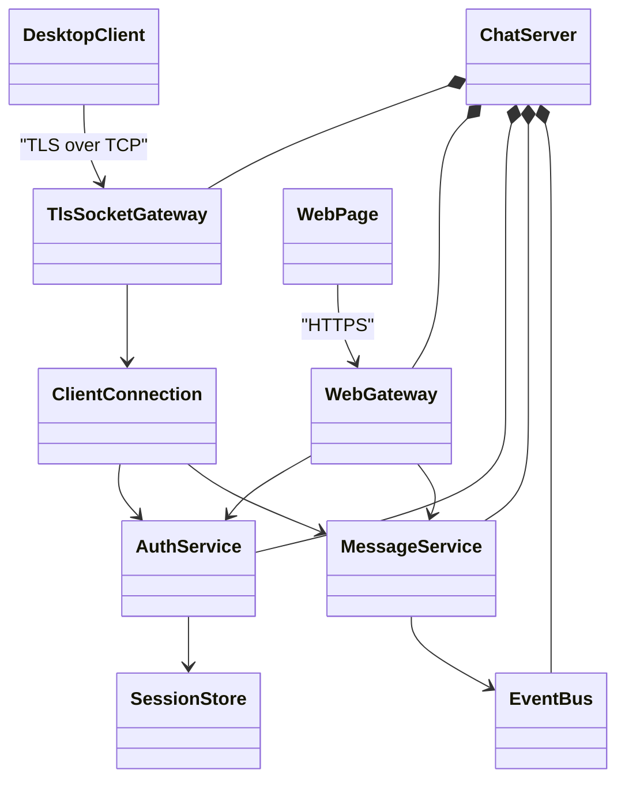

# TLS Chat

Учебный проект: защищённый корпоративный чат с шифрованием TLS.
1 сделал uml (примерный)
2 сделал прототип для презентаций (дизайн без бэка)
3 подключил git к vsc сделал клон репозитория и связал с github

## Архитектура

